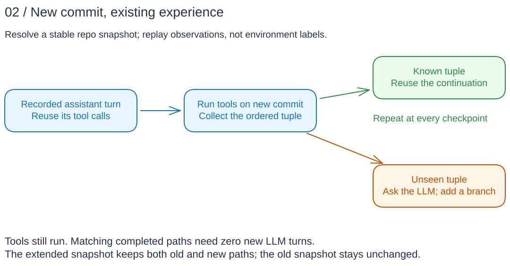
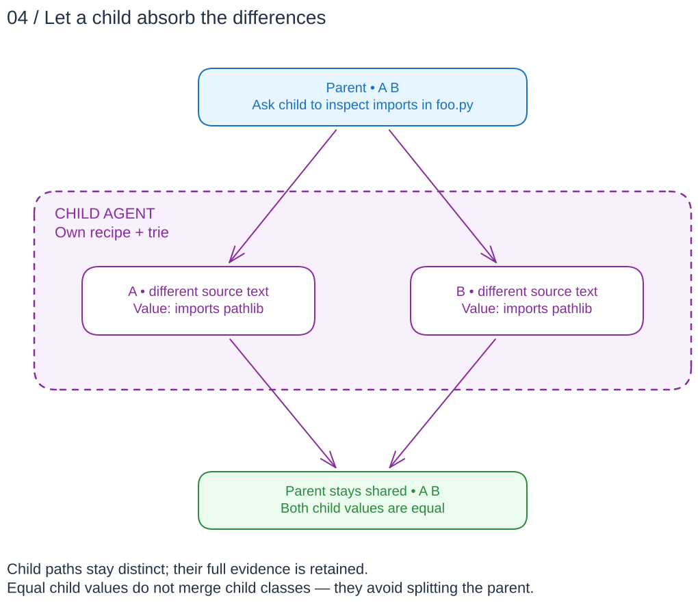

# One investigation, many environments

You have a question to ask of many subjects: products, studies, suppliers,
contracts, datasets, or repositories. Some investigations will follow the same
reasoning; others will diverge as evidence arrives. Later, new subjects or revised
evidence should benefit from what has already been investigated.

lockstep-loop records and reuses that shared work. It has no built-in domain,
model, or storage backend. The examples below use **product checks, dataset
releases, supplier review, and research screening** to explain the same machinery.

## An environment is a handle to stable evidence

For product checks, an environment handle might identify a device's versioned
datasheet. For research screening, it might identify an archived paper and its
supplements. The caller binds tools to each handle; `read_ratings()` or
`read_section("methods")` has the same interface everywhere but reads the
identified environment's evidence.

The core uses these handles to route requests. They are not model-visible
instructions. All environments in one investigation share the same ordered
initial messages and tool specifications. Inputs must be stable, and tools must be pure/read-only.
A live website, mutable database, or `HEAD` reference needs to be resolved into
stable evidence by the caller first.

## An agent is a recipe *and* its experience

The illustrations predate the API terminology change: their leaf labels “asset”
mark where a value is obtained, not a separate conversation-wrapper type, and
“initial prompt” now means one or more initial messages.

An **Agent** owns its current experience and offers the operation **investigate
environments**. Its immutable **AgentSnapshot** contains ordered initial messages,
structural configuration, and a **history trie**. The trie efficiently stores many
similar conversations by sharing their common prefixes. **AgentRun** holds the
operation's execution state and publishes a new snapshot on successful completion.

A **Conversation** is one root-to-endpoint path: initial messages, model responses,
tool calls and results, and any user follow-ups. Initial context can include a
system message and several user messages. `MessageEnvelope` carries role/call
structure; its content can be text, audio, images, or another opaque caller value.

An **asset** is the value the caller cares about, derived from that conversation.
It can be the latest model answer or the input to a typed final-answer tool such
as `submitFinalAnswer`. A/B and D above can produce equal “meets needs” assets while
retaining distinct conversations and evidence. Equal values do not merge paths.

> **API:** `agent.snapshot().conversations()` exposes snapshot-anchored
> `Conversation` views. Call `get_last_answer_asset()` or
> `get_final_tool_input_asset(tool_name)` to extract a value. The latter reads
> recorded arguments; it does not make a tool call terminal. An open conversation
> can still supply an earlier answer, or have no answer yet.
>
> [Inspect conversations and extract assets →](agent-assets.md)

## Subdivide only when evidence requires it

In the product example, A, B, C, and D are frozen specification bundles. They
initially share one conversation: “Check this device against our operating
requirements.” The assistant requests enclosure and temperature ratings. Your
application executes both tool calls in every environment.

Compare the **ordered tuple** `(enclosure output, temperature output)`. A/B/C match
and continue together; D differs and branches. A later limitations check splits
A/B from C. This is recursive subdivision, not one up-front clustering pass.
Independent calls may finish in any order; comparison waits for the whole turn
and uses call order, not arrival order.

Classes **never remerge within an execution**, even if later answers agree.
Sharing saves LLM work along common prefixes; it does not remove per-environment
tool work or guarantee unique generated tokens globally.

The drawing abbreviates evidence; the recorded agent does not. It keeps full
messages, call arguments, and actual per-environment tool outputs, not hash-only
summaries. Default grouping uses value equality. Explicit custom grouping can
share unequal outputs while retaining exact evidence separately from the
representative content used in the conversation.

## New evidence follows recorded reasoning

Consider a dataset-intake agent that has already checked schemas, column
statistics, and units. Next month's release is a **new environment**, not
necessarily a new investigation from scratch.

Reuse the agent under the same initial messages and compatible tool/nested configuration.
Rerun its recorded tools, follow matching observations, and reuse assistant turns.
A fully matching completed path needs **zero new LLM requests**. At the first
unseen observation—for example a different unit definition—ask for new reasoning.
Even a turn that originally split nobody is a checkpoint where new evidence can
diverge. Reuse also works for a different dataset with the same observed properties.

Extending experience creates a **new immutable AgentSnapshot**. Successful runs
publish automatically, so sequential starts accumulate experience. **Warning:**
overlapping runs capture independent roots and do not merge; the last completion
wins. Retain each run's snapshot to preserve independent work. Both paths within
a snapshot stay reusable; old snapshots stay unchanged. Your application can pickle
Python snapshots directly, or persist descriptors/records for lazy or incremental
storage. Changed initial-message sequences or tool specs require compatible
history selection or a fresh investigation. Pure tool implementation changes need
no version bump: tools rerun, matching outputs reuse, different outputs branch.
External provider and custom grouping policy isolation remains caller-owned;
this is not fuzzy caching. Current grouping compares fresh outputs and historical
representatives, regardless of the function used to record them. Stricter keys can
branch; coarser keys choose the first matching stored continuation without merging
history. Full new evidence and the original representative context are preserved.

The cache validates only what was observed. If units matter but no tool checked
them, replay cannot discover that omission. That is where evaluation and feedback
come in.

## Feedback continues the investigation

A supplier-review agent read a questionnaire and certificate, then answered
“evidence complete”. On review, you notice it never checked the exclusions.

Provide **agent snapshot + one stable environment + explicit feedback**. The core
replays tools to locate the existing completed endpoint, then appends your user
message. It does not generate a fresh answer merely to find a feedback target.
An unseen or unfinished target fails explicitly; ordinary replay can instead
grow unseen paths.

In the **new snapshot**, every environment reaching that path inherits the note:
A, B, and future matching evidence packs alike. Additional tools may split them.
Unrelated paths and the entire old snapshot are untouched. The former leaf becomes
a historical endpoint leading to an open continuation, not an overwritten answer.

“Evidence complete” may still be the right revised answer. Feedback is **not a
value-to-message map**: an identical answer elsewhere doesn't trigger it. Each
explicit intervention appends once at the latest completed endpoint. There are
no separate public session/endpoint handles that bypass replay.

Use transferable instructions (“check the exclusions”), not assertions only true
of one supplier, or retain a separate snapshot. Feedback improves a shared
investigation, not a private annotation on one environment.

## Subagents contain divergence—and invalidation

Two papers may describe their methods very differently while both satisfying a
review's randomization criterion. A specialized child agent investigates that
question and returns a finding. Its paths may diverge extensively; if its final
values agree, that child call does not split the parent. Different parent-visible
tuples still split normally. This is **containment, not remerging**.

There is a second payoff: **contain invalidation**. Expose a structured tool such
as `assess_design(criterion="randomized")`; application code deterministically
builds its child's initial messages. Changed parent screening instructions needn't
discard the unchanged specialist's recorded experience. Different criteria
intentionally produce different child initial messages and histories—not fuzzy
matches between paraphrases.

Subagents cost work too. Measure the child's investigation plus the parent's
continuation; fewer parent branches alone do not establish a saving. Preserve
supporting evidence and uncertainty rather than forcing every child into the
same answer for cache efficiency.

**Supported now:** multiple named `SubagentTool` definitions, deterministic
initial-message construction, bounded child allowlists, nested replay, and
independent child-agent lookup. The factory returns a nonempty ordered envelope
sequence, including system messages when needed.
Children inherit the parent's environments. A resolver selects a compatible child
revision for a new invocation; recorded parent invocations remain pinned to their
recorded revision. Concurrent updates are not silently merged.
See the [specialized-agent reference](history-reference.md#specialized-tools-and-independently-reusable-child-histories).

## Same machinery, different applications

A contract reviewer can inspect amendments; a dataset reviewer can inspect unit
definitions; a code reviewer can inspect imports. All are tool observations within
an investigation. None requires a special environment type in the core.

Choose subjects with a common task, stable evidence, and meaningful opportunities
to share observations. Exact output matching—not topic similarity—determines
reuse. For detailed environment/tool designs and poor fits, see
[use cases](use-cases.md).

The boundary stays small: the core decides what work is needed; your application
chooses how to execute and persist it. **Future, not implemented:** dependency-DAG
push updates ([issue #1](https://github.com/kaeluka/lockstep-loop/issues/1)) and
designated result-tool publication. A changed child value does not automatically
update an already completed parent.

**Next:** [Runnable examples](README.md#runnable-examples) ·
[Python API](../python/README.md) · [Rust API](../rust/README.md) ·
[Conversation inspection and asset extraction](agent-assets.md) · [Technical reference](history-reference.md)
