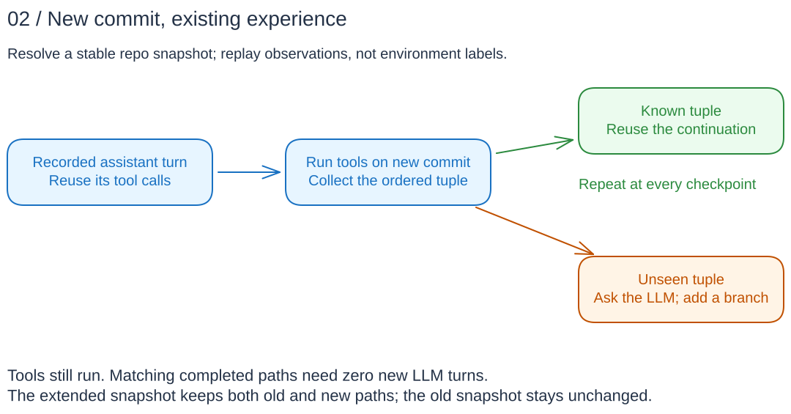
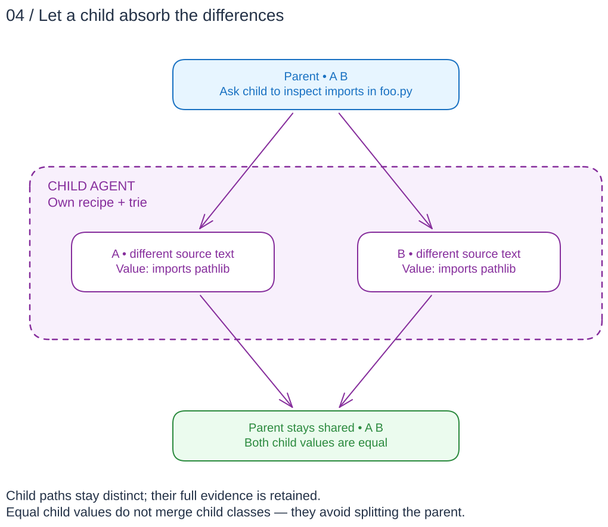

# One investigation, many environments

You have a question to ask of many subjects: products, studies, suppliers,
contracts, datasets, or repositories. Some investigations will follow the same
reasoning; others will diverge as evidence arrives. Later, new subjects or revised
evidence should benefit from what has already been investigated.

lockstep-loop records and reuses that shared work. It has no built-in domain,
model, or storage backend. The examples below use **product checks, dataset
releases, supplier review, and research screening** to explain the same machinery.

## An environment is a stable subject and its evidence

For product checks, an environment might be a device's versioned datasheet. For
research screening, it might be a paper and its supplements. The caller binds
tools to each subject; `read_ratings()` or `read_section("methods")` has the same
interface everywhere but reads that environment's evidence.

The core uses environment IDs to route requests. They are not model-visible
instructions. All environments in one investigation must have the same prompt
and tool specifications. Inputs must be stable, and tools must be pure/read-only.
A live website, mutable database, or `HEAD` reference needs to be resolved into
stable evidence by the caller first.

## An agent is a recipe *and* its experience

**Agent** means the whole trie: its initial prompt/investigation recipe, compatible
reuse contract, and accumulated experience. Not just a prompt, and not the executor
running it. A trie is a tree whose paths share their common beginnings.

**Conversation** means one root-to-endpoint path: the prompt, assistant messages,
tool calls and observations, and any later user feedback.

**Asset** means a leaf investigation state backed by that full conversation and
its published value. The value alone is not the asset: A/B and D above both say
“meets needs” but arrived there through different evidence. One leaf can represent
several environments. An open continuation need not have a new completed value yet.

> **Today's API:** `Agent` is the complete immutable snapshot (`History` remains
> an alias). `agent.assets()` exposes read-only, path-backed `Asset` views, not
> independent endpoint handles. Values are terminal assistant replies **with no
> tool calls**, not designated result-tool arguments. An open asset can retain an
> older value without having a new completed answer.
>
> [Inspect agents/assets and migrate API names →](agent-assets.md)

## Subdivide only when evidence requires it

In the product example, A, B, C, and D are frozen specification bundles. They
initially share one conversation: “Check this device against our operating
requirements.” The assistant requests enclosure and temperature ratings. Your
application executes both tool calls in every environment.

Compare the **ordered tuple** `(enclosure output, temperature output)`. A/B/C match
and continue together; D differs and branches. A later limitations check splits
A/B from C. This is recursive subdivision, not one up-front clustering pass.
Independent calls may finish in any order; comparison waits for the whole turn
and uses call order, not arrival order.

Classes **never remerge within an execution**, even if later answers agree.
Sharing saves LLM work along common prefixes; it does not remove per-environment
tool work or guarantee unique generated tokens globally.

The drawing abbreviates evidence; the recorded agent does not. It keeps full
messages, call arguments, and actual per-environment tool outputs, not hash-only
summaries. Default grouping uses value equality. Explicit custom grouping can
share unequal outputs while retaining exact evidence separately from the
representative content used in the conversation.

## New evidence follows recorded reasoning

Consider a dataset-intake agent that has already checked schemas, column
statistics, and units. Next month's release is a **new environment**, not
necessarily a new investigation from scratch.

Reuse the agent under the same prompt and compatible tool/grouping contract.
Rerun its recorded tools, follow matching observations, and reuse assistant turns.
A fully matching completed path needs **zero new LLM requests**. At the first
unseen observation—for example a different unit definition—ask for new reasoning.
Even a turn that originally split nobody is a checkpoint where new evidence can
diverge. Reuse also works for a different dataset with the same observed properties.

Extending experience creates a **new immutable agent snapshot**. Both paths stay
reusable; the old snapshot stays unchanged. Your application persists descriptors
and records using its own storage. Changing the prompt or tool semantics requires
compatible history selection or a fresh investigation; this is not fuzzy caching.

The cache validates only what was observed. If units matter but no tool checked
them, replay cannot discover that omission. That is where evaluation and feedback
come in.

## Feedback continues the investigation

A supplier-review agent read a questionnaire and certificate, then answered
“evidence complete”. On review, you notice it never checked the exclusions.

Provide **agent snapshot + one stable environment + explicit feedback**. The core
replays tools to locate the existing completed endpoint, then appends your user
message. It does not generate a fresh answer merely to find a feedback target.
An unseen or unfinished target fails explicitly; ordinary replay can instead
grow unseen paths.

In the **new snapshot**, every environment reaching that path inherits the note:
A, B, and future matching evidence packs alike. Additional tools may split them.
Unrelated paths and the entire old snapshot are untouched. The former leaf becomes
a historical endpoint leading to an open continuation, not an overwritten answer.

“Evidence complete” may still be the right revised answer. Feedback is **not a
value-to-message map**: an identical answer elsewhere doesn't trigger it. Each
explicit intervention appends once at the latest completed endpoint. There are
no separate public session/endpoint handles that bypass replay.

Use transferable instructions (“check the exclusions”), not assertions only true
of one supplier, or retain a separate snapshot. Feedback improves a shared
investigation, not a private annotation on one environment.

## Subagents contain divergence—and invalidation

Two papers may describe their methods very differently while both satisfying a
review's randomization criterion. A specialized child agent investigates that
question and returns a finding. Its paths may diverge extensively; if its final
values agree, that child call does not split the parent. Different parent-visible
tuples still split normally. This is **containment, not remerging**.

There is a second payoff: **contain invalidation**. Expose a structured tool such
as `assess_design(criterion="randomized")`; application code deterministically
builds its child prompt. A changed parent screening prompt needn't discard the
unchanged specialist's recorded experience. Different criteria intentionally
produce different child prompts/tries—not fuzzy matches between paraphrases.

Subagents cost work too. Measure the child's investigation plus the parent's
continuation; fewer parent branches alone do not establish a saving. Preserve
supporting evidence and uncertainty rather than forcing every child into the
same answer for cache efficiency.

**Supported now:** multiple named `SubagentTool` definitions, deterministic prompt
construction, bounded child allowlists, nested replay, and independent child-agent
lookup. The initial prompt is a user message, not a separate system-role API.
Children inherit the parent's environments. A resolver selects a compatible child
revision for a new invocation; recorded parent invocations remain pinned to their
recorded revision. Concurrent updates are not silently merged.
See the [specialized-agent reference](history-reference.md#specialized-tools-and-independently-reusable-child-histories).

## Same machinery, different applications

A contract reviewer can inspect amendments; a dataset reviewer can inspect unit
definitions; a code reviewer can inspect imports. All are tool observations within
an investigation. None requires a special environment type in the core.

Choose subjects with a common task, stable evidence, and meaningful opportunities
to share observations. Exact output matching—not topic similarity—determines
reuse. For detailed environment/tool designs and poor fits, see
[use cases](use-cases.md).

The boundary stays small: the core decides what work is needed; your application
chooses how to execute and persist it. **Future, not implemented:** dependency-DAG
push updates ([issue #1](https://github.com/kaeluka/lockstep-loop/issues/1)) and
designated result-tool publication. A changed child value does not automatically
update an already completed parent.

**Next:** [Runnable examples](README.md#runnable-examples) ·
[Python API](../python/README.md) · [Rust API](../rust/README.md) ·
[Asset inspection](agent-assets.md) · [Technical reference](history-reference.md)
